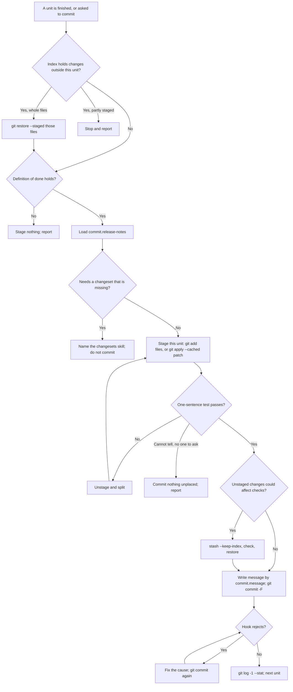

# commit

## What

A unit of work is finished and has to become a commit. Left alone, an agent reaches for the
interactive commands a person would use (`git add -p`, `git restore --staged -p`, `git commit -v`),
cannot drive them, and falls back to `git add .`, which sweeps in whatever else is in the tree. It
verifies after committing, not before, commits files someone else staged, tests the working tree
while committing the index, and answers a hook rejection with `--no-verify` or `--amend`.

`commit` stages and commits **one unit of work at a time**, safely enough to run unattended. It
replaces two skills: the community `commit-work` (softaworks/agent-toolkit, abandoned upstream) and the
owner's minimal `commit` in cyberuni/cyberplace `plugins/commit-discipline`, whose content it keeps.
It depends on neither.

**Repository rules win.** The **Commit Discipline** section of `AGENTS.md` or `CLAUDE.md`, and a
`SKILL.local.md` beside the skill, take precedence over its defaults.

**Every command is agent-runnable.** Staging is by name (`git add <files>`), or, for part of a file, a
patch of this unit's hunks staged with `git apply --cached`. Nothing opens an editor, a pager, or a
prompt: no `git add .`, `-A`, `-p`, `git restore -p`, or a bare `git commit`. Messages go in with
`git commit -F <file>` or `-m`, keeping the trailers the harness or repository supplies.

**Done comes before staging.** Build, tests, lint, a runtime surface exercised once, and docs. Because
the checks read the working tree, the skill verifies the staged snapshot (setting the unstaged part
aside with `git stash push --keep-index --include-untracked`) whenever unstaged changes could change the
result, and says why when it skips that.

**The index is checked first.** Changes already staged that are not this unit are unstaged, or, when
unstaging would lose someone's partial selection, the skill stops and reports. They are never
committed along.

**A hook rejection means the commit did not happen.** The skill fixes the cause and runs `git commit`
again. It never passes `--no-verify` and never amends, and never pushes, forces, or rewrites history.

**Two rules are references a repository overrides.** `commit.message` (default: Conventional Commits,
with types, scopes, subject case, and lengths read from the commitlint config) and
`commit.release-notes` (default: a change to a published package carries its changeset when the
repository has `.changeset/config.json`; otherwise nothing). Both ship in `packages/buddy/references/`
with a bundled `.default.md` copy in the skill, loaded through cyber-agentkit's `reference` skill, and
overridden one section at a time in `.agents/references/<name>.md`. Writing a changeset is not this
skill's job; it names the `changesets` skill from repobuddy/buddy-changesets.

**It decides instead of asking.** Each choice is settled from the rules and the references. It asks
only when they cannot decide; with no one to answer, it stops and reports what is left uncommitted.

### Non-goals

- Stack-specific verification (Storybook, endpoints). One generic line: exercise a runtime surface once.
- Split detection by file pattern or directory. The one-sentence test ("an 'and' means two commits")
  decides.
- A new config file format. `AGENTS.md`, `SKILL.local.md`, and the two references cover overrides.
- Writing changesets, pushing, opening pull requests, squashing, or any history rewrite.

## Use Cases

**Fit:** high

Its triggers ("commit this", "split into commits", "write a commit message") are distinct from
pushing, releasing, and changeset authoring, which belong to other skills. The judgment is where a
unit ends; the rest is a fixed, safe sequence of git commands.

**Actors.** An *agent* commits, often with no one watching. A *developer* asks for a commit or has
left staged work in the index. A *repository* supplies rules, hooks, and reference overrides.

| # | Use case (surface: `/commit`) | Actor / goal | Entry point | Extensions |
|---|---|---|---|---|
| 1 | **Commit one unit** | Agent: turn a finished change into one commit | Trigger: a unit is done, or the developer says "commit". Outcome: one commit holding only that unit | 1–8 |
| 2 | **Split into units** | Agent: turn a mixed working tree into several commits | Trigger: "split these into commits", or the one-sentence test fails. Outcome: one commit per unit | 1–9 |

**Extensions:**

1. **The index holds changes outside this unit.** They are unstaged; when a file is partly staged, the skill stops and reports.
2. **The change is not done.** Nothing is staged; the failing check is reported.
3. **Unstaged changes could affect the checks.** The staged snapshot is verified with the unstaged part set aside, then restored.
4. **A hook rejects the commit.** The cause is fixed and `git commit` runs again, with no `--no-verify` or `--amend`.
5. **The repository has a commitlint config.** The message follows its rules.
6. **The repository overrides a reference.** The override's sections replace the default's.
7. **The `reference` command cannot run.** The bundled default, then any `.agents/references/` override, is read.
8. **The repository uses changesets.** A published change carries its changeset; a missing one is handed to the `changesets` skill.
9. **The rules cannot place a change.** With no one to answer, the skill commits nothing it cannot place and reports.

## Control Flow

## Scenario map

| Edge | Path (Given) | Scenario |
|---|---|---|
| `A` (engage) | a repo with repobuddy and buddy-changesets installed | `engages to commit work, not to push, release, or write a changeset` |
| `S` (by file) | a bugfix and an unrelated docs edit in two files | `splits a change across files by staging each unit's files by name` |
| `S` (by hunk) | two hunks of one file for two units | `stages part of one file with a patch of hunks` |
| `M` | a unit whose message needs a body | `runs no command that opens an editor or a pager` |
| `—` (artifact) | the shipped skill | `does not defer to another commit skill` |
| `M` (commitlint) | a commitlint config with its own header length and type-enum | `reads the allowed types, scope, and header length from the commitlint config` |
| `M` (override) | an override of the `Type` section | `uses a section of the repository's override in place of the default` |
| `M` (no command) | the `reference` command not installed | `reads the bundled default when the reference command cannot run` |
| `H → H1` (message) | a commit-msg hook rejects the subject case | `commits again after a commit-msg hook rejects the message` |
| `H → H1` (code) | a pre-commit lint failure | `fixes the code when a pre-commit hook fails a check` |
| `I → I1` | an unrelated file already staged | `unstages files that are not this unit before committing` |
| `I → I2` | an unrelated file partly staged | `stops when unstaging would lose a partial selection` |
| `V → V1` | an unstaged change the staged change depends on | `verifies the staged snapshot when unstaged changes could hide a failure` |
| `V → M` | only an unstaged typo no check reads | `skips the snapshot check when unstaged changes cannot affect it` |
| `D → D1` | failing tests | `does not stage a change that is not done` |
| `M` (trailers) | the harness supplies Co-Authored-By | `keeps the trailers the harness supplies` |
| `T → T1` | a feature and an unrelated CI change, no one present | `decides the split from the rules without asking up front` |
| `T → T2` | a hunk serving two units, no one present | `stops and reports when the rules cannot decide` |
| `H1` | a pushed last commit and a hook rejection | `never pushes or rewrites history` |
| `R0 → S` | a published change with its changeset | `commits the changeset with the change in a repository that uses changesets` |
| `R0 → R1` | a published change with no changeset | `hands writing a changeset to the changesets skill` |
| `R` (none) | no `.changeset/config.json` | `adds no release notes in a repository without changesets` |
| `—` (artifact) | the shipped skill | `ships a Validate section whose mechanical assertions pass` |
