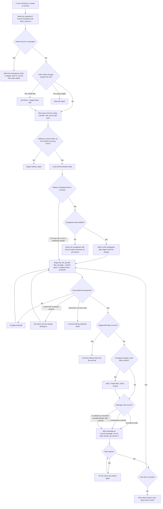

# commit

## What

A unit of work is finished and has to become a commit. Left alone, an agent reaches for the
interactive commands a person would use (`git add -p`, `git restore --staged -p`, `git commit -v`),
cannot drive them, and falls back to `git add .`, which sweeps in whatever else is in the tree. It
verifies after committing, not before, commits files someone else staged, tests the working tree
while committing the index, and answers a hook rejection with `--no-verify` or `--amend`.

`commit` stages and commits **one unit of work at a time**, safely enough to run unattended. It
replaces two skills: the community `commit-work` (softaworks/agent-toolkit, abandoned upstream) and the
owner's minimal `commit` in cyberuni/cyberplace `plugins/commit-discipline`, whose content it keeps.
It depends on neither.

**Repository rules win.** The **Commit Discipline** section of `AGENTS.md` or `CLAUDE.md`, and a
`SKILL.local.md` beside the skill, take precedence over its defaults.

**Every command is agent-runnable.** Staging is by name (`git add <files>`), or, for part of a file, a
patch of this unit's hunks staged with `git apply --cached`. Nothing opens an editor, a pager, or a
prompt: no `git add .`, `-A`, `-p`, `git restore -p`, or a bare `git commit`. Messages go in with
`git commit -F <file>` or `-m`, keeping the trailers the harness or repository supplies.

**Done comes before staging.** Build, tests, lint, a runtime surface exercised once, and docs. Because
the checks read the working tree, the skill verifies the staged snapshot (setting the unstaged part
aside with `git stash push --keep-index --include-untracked`) whenever unstaged changes could change the
result, and says why when it skips that.

**The index is checked first.** Changes already staged that are not this unit are unstaged, or, when
unstaging would lose someone's partial selection, the skill stops and reports. They are never
committed along.

**A hook rejection means the commit did not happen.** The skill fixes the cause and runs `git commit`
again. It never passes `--no-verify` and never amends, and never pushes, forces, or rewrites history.

**Two rules are references a repository overrides.** `commit.message` (default: Conventional Commits,
with types, scopes, subject case, and lengths read from the commitlint config) and
`commit.release-notes` (default: a change to a published package carries its changeset when the
repository has `.changeset/config.json`; otherwise nothing). Both ship in `packages/buddy/references/`
with a bundled `.default.md` copy in the skill, loaded through cyber-agentkit's `reference` skill, and
overridden one section at a time in `.agents/references/<name>.md`. Writing a changeset is not this
skill's job; it names the `changesets` skill from repobuddy/buddy-changesets.

**It decides instead of asking.** Each choice is settled from the rules and the references. It asks
only when they cannot decide; with no one to answer, it stops and reports what is left uncommitted.

### Revision 2: commit-work's splitting and lean run as the baseline

The owner found that the first version used many tokens and split work worse than the community
`commit-work`. Revision 2 takes `commit-work`'s splitting and its lean run as the baseline and keeps
every feature above on top of it. Where the two disagree, the table says which side wins and why.

**Taken from `commit-work`:**

- **Plan every commit before staging the first.** Read `git status --porcelain` and
  `git --no-pager diff --stat`, assign each file (or hunk) to a unit, and only then stage. The first
  version found units one at a time and re-read the whole tree for each.
- **Split on named axes.** Formatting or whitespace apart from logic; a refactor apart from the feature
  or fix that follows it; a dependency bump apart from a behavior change; unrelated areas apart. The
  one-sentence test still settles a case the axes do not.
- **Read only as much diff as the split needs.** The stat first; the full diff only of the files whose
  unit the stat and the path do not settle, and only for a split inside a file.
- **The smallest check that covers the unit.** Run the fastest check that reads the unit's files (the
  affected package's tests, lint on those files), not the full validation command for every commit. Run
  the full command once, before the last commit of the run, when the change is broad. A check already
  passed in this session on content that has not changed since is not run again.
- **Sanity-check the staged diff.** Before committing, look for a secret or token, debug logging, and
  formatting churn the unit did not ask for. A secret stops the commit; debug logging and churn are
  taken out of the unit.
- **What and why.** The one-sentence description says what changed, and the message body says why.
- **A report.** The reply lists each commit (short hash, subject, what and why in one line), the checks
  run, and what was left uncommitted and why.

**Where they conflict:**

| # | `commit-work` | Revision 2 | Wins | Why |
|---|---|---|---|---|
| D1 | `git add -p`, `git restore --staged -p`, `git commit -v` | Stage by name or by patch with `git apply --cached`; `git commit -F` | repobuddy | An agent cannot drive an interactive prompt or an editor, and falls back to `git add .` |
| D2 | Asks single or multiple commits, the style, and the rules | Decides: several commits when the changes are unrelated; the rules come from the repository and the references | repobuddy, with `commit-work`'s default | It runs unattended; `commit-work`'s own default is the answer it would get |
| D3 | Splits tests from production code | A change's tests go in its commit; a test-only change is its own unit | repobuddy | A commit is independently revertable; reverting a fix without its tests, or tests without the fix, leaves a broken tree |
| D4 | Verifies after staging, "before moving on" | Verifies before committing; never commits with a red check | repobuddy, scoped to `commit-work`'s smallest check | A commit that fails its checks is not done; the scope keeps it cheap |
| D5 | Conventional Commits, fixed | `commit.message` reference, Conventional Commits by default, rules from commitlint | repobuddy | A repository overrides the convention one section at a time |
| D6 | No index check, no snapshot check, no hook recovery, no release notes | All kept, each run only when its condition holds | repobuddy | They are the features the owner asked to keep; conditional, they cost nothing on the common path |

**Leaner than the first version, without dropping a feature:**

- The two references are read as files: the bundled default in the skill's `references/`, then
  `.agents/references/<name>.md` when it exists, each of its sections replacing the default's section of
  the same heading. Loading the `reference` skill to do the same cost a skill load on every commit.
  The override behavior is unchanged.
- `references/splitting.md` is read only for a split inside one file or a snapshot check.
- The checks after a commit run once, after the last commit, not after each one.
- Hooks are found once per run.

### Non-goals

- Stack-specific verification (Storybook, endpoints). One generic line: exercise a runtime surface once.
- Split detection by a fixed file-pattern table. The axes above and the one-sentence test decide.
- A new config file format. `AGENTS.md`, `SKILL.local.md`, and the two references cover overrides.
- Writing changesets, pushing, opening pull requests, squashing, or any history rewrite.

## Use Cases

**Fit:** strong

Its triggers ("commit this", "split into commits", "write a commit message") are distinct from
pushing, releasing, and changeset authoring, which belong to other skills. The judgment is where a
unit ends; the rest is a fixed, safe sequence of git commands.

**Actors.** An *agent* commits, often with no one watching. A *developer* asks for a commit or has
left staged work in the index. A *repository* supplies rules, hooks, and reference overrides.

| # | Use case (surface: `/commit`) | Actor / goal | Entry point | Extensions |
|---|---|---|---|---|
| 1 | **Commit one unit** | Agent: turn a finished change into one commit | Trigger: a unit is done, or the developer says "commit". Outcome: one commit holding only that unit | 1–20 |
| 2 | **Split into units** | Agent: turn a mixed working tree into several commits | Trigger: "split these into commits", or the one-sentence test fails. Outcome: a plan of every unit, then one commit per unit | 1–13, 15–20 |

**Extensions:**

1. **The index holds changes outside this unit.** They are unstaged; when a file is partly staged, the skill stops and reports.
2. **The change is not done.** Nothing is staged; the failing check is reported.
3. **Unstaged changes could affect the checks.** The staged snapshot is verified with the unstaged part set aside, then restored.
4. **A hook rejects the commit.** The cause is fixed and `git commit` runs again, with no `--no-verify` or `--amend`.
5. **The repository has a commitlint config.** The message follows its rules.
6. **The repository overrides a reference.** The override's sections replace the default's.
7. **The `reference` command cannot run.** The bundled default, then any `.agents/references/` override, is read.
8. **The repository uses changesets.** A published change carries its changeset. A missing one is written with the `changesets` skill when it is installed; otherwise the skill names it and commits nothing. A change outside any published package carries none.
9. **The rules cannot place a change.** Someone present is asked; with no one to answer, the skill commits nothing it cannot place and reports.
10. **The repository has its own Commit Discipline.** Its rules replace the skill's defaults where they differ.
11. **Changes of two units share one hunk.** The patch is built with no context (`-U0`) and staged with `--unidiff-zero`.
12. **The repository has commit hooks.** The skill says what they run and runs those checks before committing.
13. **One changed run holds both units.** The file's content for this commit is written outside the repository and staged directly with `git update-index --cacheinfo`.
14. **Asked only for a message.** What is staged is the unit: the message is written for it and shown, and the commit is made only when asked.
15. **The tree mixes formatting and logic.** The formatting-only change is its own commit, before the logic.
16. **The tree mixes a dependency bump and a behavior change.** The bump is its own commit.
17. **A change comes with its tests.** The tests go in the change's commit, not in a commit of their own.
18. **The staged diff holds a secret or token.** Nothing is committed; the file and line are reported. Debug logging the unit did not ask for is taken out of the unit instead.
19. **A check already passed on the same content in this session.** It is not run again; the reply says which check it reused.
20. **The run ends.** The reply lists each commit (short hash, subject, what and why), the checks run, and what was left uncommitted and why.

## Control Flow

## Scenario map

| Edge | Path (Given) | Scenario |
|---|---|---|
| `A` (engage) | a repo with repobuddy and buddy-changesets installed and uncommitted changes | `engages to commit work, not to push, release, amend, or write a changeset` |
| `A1` | a Commit Discipline section that splits by package | `follows the repository's Commit Discipline over its own defaults` |
| `Q → Q1` | a developer's partly staged file and "write a commit message for what I staged" | `writes the message for what the developer staged and commits only when asked` |
| `A1` (local) | a `SKILL.local.md` that adds a ticket id | `follows SKILL.local.md over its own defaults` |
| `S` (by file) | a bugfix and an unrelated docs edit in two files | `splits a change across files by staging each unit's files by name` |
| `S` (by hunk) | two hunks of one file for two units | `stages part of one file with a patch of hunks` |
| `S` (shared hunk) | two units' changes in one hunk | `splits two units whose changes share one hunk` |
| `S` (one run) | two units' changes on adjacent lines | `stages one unit's lines from a changed run that holds both units` |
| `M` | a unit whose message needs a body | `runs no command that opens an editor or a pager` |
| `—` (artifact) | the shipped skill's SKILL.md and references/ text | `does not defer to another commit skill` |
| `M` (commitlint) | a commitlint config with its own header length and type-enum | `reads the allowed types, scope, and header length from the commitlint config` |
| `M` (override) | an override of the `Type` section | `uses a section of the repository's override in place of the default` |
| `M` (no command) | the `reference` command not installed | `reads the bundled default when the reference command cannot run` |
| `M` (no command, override) | the `reference` command not installed and an override of `Type` | `applies an override's section by hand when the reference command cannot run` |
| `M` (breaking) | a change that removes an export | `marks a change that breaks a consumer` |
| `M` (hooks) | husky pre-commit and commit-msg hooks | `runs the repository's hook checks before committing` |
| `H → H1` (message) | a commit-msg hook rejects the subject case | `commits again after a commit-msg hook rejects the message` |
| `H → H1` (code) | a pre-commit lint failure | `fixes the code when a pre-commit hook fails a check` |
| `I → I1` | an unrelated file already staged | `unstages files that are not this unit before committing` |
| `I → I2` | an unrelated file partly staged | `stops when unstaging would lose a partial selection` |
| `V → V1` | an unstaged change the staged change depends on | `verifies the staged snapshot when unstaged changes could hide a failure` |
| `V → M` | only an unstaged typo no check reads | `skips the snapshot check when unstaged changes cannot affect it` |
| `D → D1` | failing tests | `does not stage a change that is not done` |
| `D` (runtime surface) | a new CLI flag with passing tests | `exercises a changed CLI once before staging` |
| `M` (trailers) | the harness supplies Co-Authored-By | `keeps the trailers the harness supplies` |
| `T → T1` | a feature and an unrelated CI change, no one present | `decides the split from the rules without asking up front` |
| `T → T3` | one changed line two units need, the developer present | `asks the developer when the rules cannot place a change` |
| `T → T2` | one changed line two units need, no one present | `stops and reports when the rules cannot decide` |
| `H → H1 → C` | a hook rejection on a branch that tracks origin | `never pushes or rewrites history` |
| `R0 → S` | a published change with its changeset | `commits the changeset with the change in a repository that uses changesets` |
| `RI → R2` | a published change with no changeset, the changesets skill installed | `writes a missing changeset through the changesets skill and commits it with the change` |
| `RI → R1` | a published change with no changeset, the changesets skill not installed | `names the changesets skill and commits nothing when it is not installed` |
| `R0 → S` (unpublished) | a CI-only change in a changesets repository | `carries no changeset for a change outside any published package` |
| `R0 → S` (private) | a change to a `"private": true` package in a changesets repository | `carries no changeset for a change to a private package` |
| `R` (none) | no `.changeset/config.json` | `adds no release notes in a repository without changesets` |
| `—` (artifact) | the shipped skill's frontmatter and its bundled reference copies | `ships a skill file whose frontmatter and bundled reference copies are valid` |
| `C` (Done when) | two units on a branch that tracks origin | `leaves the repository in the state its Done when section checks` |
| `P` | a bugfix, its test, a docs edit, and a reformat of another file | `plans every commit before staging the first` |
| `P` (formatting) | a reformat of one file and a logic change in another | `commits a formatting-only change apart from logic` |
| `P` (dependency) | a dependency bump and a behavior change | `commits a dependency bump apart from a behavior change` |
| `P` (tests) | a bugfix and the test that covers it | `keeps a change's tests in the change's commit` |
| `P` (lean read) | forty changed files across two packages | `reads the diff stat before any full diff` |
| `D` (smallest check) | a one-package change in a monorepo with a full verify command | `runs the smallest check that covers the unit` |
| `D` (reuse) | the unit's tests passed earlier in the session on the same content | `does not rerun a check that passed on unchanged content` |
| `X → X1` | a staged file that adds an API token | `commits nothing when the staged diff holds a secret` |
| `X` (debug) | a staged console.log the unit did not ask for | `takes debug logging out of the unit` |
| `C` (report) | two units committed | `reports each commit, the checks run, and what was left` |
| `—` (artifact) | the shipped skill's SKILL.md | `loads the references as files, not through the reference skill` |
