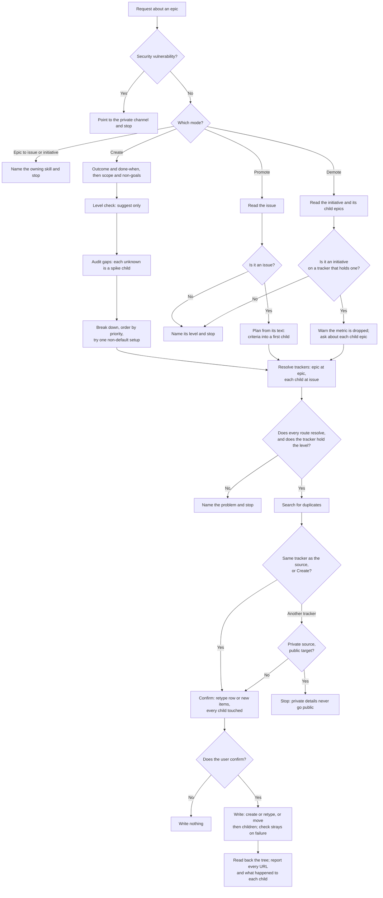

# epic

## What

Work too big for one issue needs an outcome, a breakdown into independently shippable issues, and a
parent that is done when they are. Left alone, an agent names children before the outcome is settled,
bakes guesses into them, files a duplicate of an issue that already exists, and, when it changes an
item's level, closes or drops children nobody listed.

`epic` is a **routing skill** ([ADR 0002](../../design/decisions/0002-routing-skills-are-named-noun-first.md))
that owns entry into the epic level ([ADR 0003](../../design/decisions/0003-split-file-issue-by-level.md),
decision 2). It has three modes:

- **Create**: an epic and its child issues. The outcome and done-when come first, then the non-goals,
  a gap audit that turns each unknown into a **spike** child, a breakdown ordered by the owner's
  priority, a duplicate search, one confirmation for the whole plan, and the filing.
- **A shell** that `initiative` filed (an epic with an outcome and no children) is broken down by
  Create: found by the duplicate search, it becomes the epic, and only its children are created.
- **Promote** (issue → epic): the issue stays in place as the epic where the tracker allows, and its
  acceptance criteria move into a first child.
- **Demote** (initiative → epic): the metric is shown and the user is warned it is dropped; each child
  epic is decided one by one.

Epic → issue and epic → initiative are not this skill's: the skill of the level being entered owns a
level change (ADR 0003), so `epic` says which skill and stops.

**How a level changes is the tracker's; the guards are the skill's** (ADR 0003, decision 7). Each
capabilities reference's `Retype` section says, per change, whether it is in place or a new item, what
happens to open children, and the limits; a team overrides that section with `merge-sections`. The
skill keeps five guards no reference or team can change: confirm before any write; list every child
the change touches; never close a child as a duplicate; never drop a child without saying where it
went; never put a private tracker's details into a public one. A sixth, from the `issue` spec: check
for a stray item after a failed create before any retry. Where a reference is silent or marks
`Retype` unsupported, the skill creates at the new level, links, and closes the old item as moved
after confirmation.

**A level change may cross trackers** (decision 9). When the routing puts the epic level on another
tracker than the source item, the skill creates the epic there, links the two, and closes the source
as moved or keeps it open as a mirror, per the routing's `Moves` row (no row means `moved`). A move
from a private tracker to a public one stops, with a row or without. When the source is public and the
target private, the source's comment says only that the work is tracked internally.

**Trackers are resolved as `issue` resolves them**: the routing's first matching row when one exists,
else the `origin` host and the installed `project-tracker.capabilities.*` references, with the bundled
GitHub and GitLab copies as the fallback. The epic resolves at level epic, each child at level issue with its own
category, so an epic and its children may sit on different trackers; a child on another tracker is
linked in its body. Children are filed through `issue` when it is installed.

**This child's capabilities.** GitHub's `Retype` ships here, in place by label, with the body rewrite
for issue → epic and the detach for initiative → epic spelled out. Asana's ships in `cyber-asana`
(`project-tracker.capabilities.asana`, cyberuni/cyber-asana#266): in place by subtasks for issue ↔ epic,
initiative unsupported. GitLab's ships here too (#806): in place by the `epic` label on Free, a new
group epic by `/promote_to Epic` on Premium and Ultimate, initiative on Ultimate only; its calls are
untested on a real instance.

### Non-goals

- Epic → issue and epic → initiative (`issue` and `initiative`).
- Filing one issue (`issue`), setting up the routing (`project-tracker`), commenting (`to-question`).
- A standalone move of an epic that is already at the epic level, because the routing changed.
- Editing an epic's children after it is filed (re-parenting, re-ordering, closing).
- Asana's capabilities text; it lives in `cyber-asana`. GitLab's is specified by #806.

### Input from the hand-run epic

The `issue`, `epic`, `initiative` epic (#801) was planned by hand the way this skill runs it; its
[plan](../../../plans/issue-epic-initiative.plan.md) records the steps. Taken here: outcome and
done-when before any child (note 1); audit for gaps, then spike the unknowns (2, 3); order by the
owner's priority (8); try one non-default setup against the breakdown (11); filing reads types and
labels first, creates the level label only on a yes, files the parent then each child with its
category, attaches a cross-repository child by URL, and reads back the count (12); check for a stray
after a failed create in a batch (14); ask for the category before resolving a tracker (17). Not taken:
per-child pod hand-off notes (13, 15, 16), which are how this repository runs children, not how a
tracker files them.

## Use Cases

**Fit:** strong

Its triggers ("epic", "break down", "promote") sit next to `issue` and `project-tracker`, and every
step is judgment: what is unknown, how to split, what happens to each child.

**Actors.** A *planner* (maintainer or lead) runs the skill. `issue` is invoked by it to file each
child. A *capabilities author* supplies `Retype`; a *team* overrides it. A *private-tracker owner* is
affected by a move.

| # | Use case (surface: `/epic`) | Actor / goal | Entry point | Extensions |
|---|---|---|---|---|
| 1 | **Create** | Planner: file an epic and its child issues | Trigger: asks to plan an epic or break work down. Outcome: the epic and each child filed and linked | 1–8, 13 |
| 2 | **Promote** | Planner: turn an issue that grew into an epic | Trigger: asks to promote an issue or make it an epic. Outcome: the epic, in place or on the target tracker, with children | 1–5, 9–13 |
| 3 | **Demote** | Planner: turn an initiative without a metric into an epic | Trigger: asks to demote an initiative. Outcome: the epic, each child epic decided | 1–5, 10–12, 14, 15 |

**Extensions:**

1. **A security vulnerability.** The skill points to the private channel and stops.
2. **The routing does not resolve** (a missing or ambiguous pin, no matching route). The skill names it, suggests `project-tracker`, and stops.
3. **The tracker does not hold the level.** The skill says so and stops; it does not file a plain issue.
4. **The user declines the confirmation.** Nothing is written.
5. **A level check fails.** The skill suggests the other level and continues only on the user's word.
6. **An unknown in the scope.** It becomes a spike child, ordered before the children that depend on it.
7. **A duplicate search hit.** A hit for a child is attached, not created; a hit for the epic offers Promote or Demote on it, or, when it is a shell epic with no children, becomes the epic Create breaks down.
8. **A create fails.** The skill looks for the item it left behind before the next child or any retry.
9. **The source is not at the level the mode expects.** The skill names its level and stops.
10. **The epic level routes to another tracker.** The change becomes a move.
11. **The move goes from a private tracker to a public one.** The skill stops.
12. **The source is public and the target private.** The source's comment carries no title or URL.
13. **The level label is missing.** It is created only on a yes.
14. **A child epic should become an issue.** That is epic → issue; the skill names `issue` and leaves the child attached.
15. **The tracker holds no initiative level** (Asana). Demote stops.

## Control Flow

## Scenario map

| Edge | Path (Given) | Scenario |
|---|---|---|
| `A` (engage) | a repo where `issue` and `project-tracker` are installed | `engages to plan an epic or move work into the epic level, not to file one issue` |
| `B → B1` | the request describes a way to read others' data | `points a vulnerability to the private channel and files nothing` |
| `C → C1` | asked to turn an epic into an issue | `names the owning skill for a level change out of the epic level` |
| `C → D` | asked to plan an epic with no outcome stated | `asks for the outcome and done-when before naming any child` |
| `D2` | a scope with one undecided question | `files an unknown as a spike child, not a guess` |
| `R → R0 (No)` | a routing with no row for epic | `stops when the epic level has no route` |
| `R0 → R1 (No)` | the tracker's reference does not hold initiative | `stops demoting on a tracker that holds no initiative` |
| `S` | a search hit the user says is a child | `attaches an existing item instead of filing a duplicate child` |
| `S` | a search hit the user says is the epic, a shell with no children | `breaks down a shell epic instead of filing a second one` |
| `N → N1 (No)` | the plan shown and declined | `writes nothing when the user declines the plan` |
| `N → W (Yes)` | the GitHub repo lacks the `epic` label | `creates a missing level label only on a yes` |
| `W` | a child create fails and leaves an issue behind | `checks for a stray child before filing the next one` |
| `P → P2`, `X → K` | an issue on GitHub, epics routed to GitHub | `promotes an issue in place and moves its criteria into a first child` |
| `P0 → P1` | the source already carries the `epic` label | `stops promoting an item that is not an issue` |
| `X → V → K` | an issue on public GitHub, epics routed to private Asana | `moves a promoted issue to the tracker that holds epics` |
| `V → V1` | an issue on private Asana, epics routed to public GitHub | `stops a move from a private tracker to a public one` |
| `M1` | an initiative with a metric and two child epics | `warns the metric is dropped and asks about each child epic` |
| `M1` | the user wants a child epic folded in as an issue | `leaves a child epic attached when it should become an issue` |
| `Y` | a filed plan | `reports every child and what happened to it` |
| `—` (artifact) | the shipped skill | `ships a Validate section whose mechanical assertions pass` |
