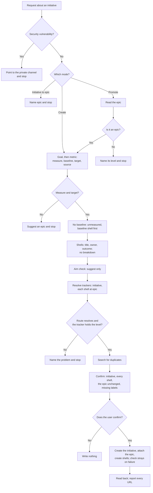

# initiative

## What

A goal that needs several epics is done when a measure moves, not when the epics close. Left alone, an
agent files it as a big epic with no metric, guesses a baseline or a target, breaks every epic into
issues before any of them has started, and, promoting an epic, relabels it so the epic's issues pose as
the initiative's epics.

`initiative` is a **routing skill** ([ADR 0002](../../design/decisions/0002-routing-skills-are-named-noun-first.md))
that owns entry into the initiative level ([ADR 0003](../../design/decisions/0003-split-file-issue-by-level.md),
decision 2). It has two modes:

- **Create**: an initiative and its epics as **shells**. The goal comes first, then one metric (measure,
  baseline, target, source), the time horizon and the owners, then the shells (title, category, owner,
  one-line outcome) in the owner's priority, an aim check, a duplicate search, one confirmation, and
  the filing.
- **Promote** (epic → initiative): a **new parent**. The initiative is created above the epic, and the
  epic, unchanged, is its first shell.

Initiative → epic is `epic`'s (Demote), so `initiative` says so and stops. There is no level above, so
nothing demotes into an initiative.

**No metric, no initiative.** Without a measure and a target the skill suggests an epic with the goal as
its outcome. A baseline nobody has read is written `unmeasured`, and measuring it becomes the first
shell; the skill never guesses a number. Two measures mean two initiatives (the level's `Too big`).

**A shell stays a shell.** The skill files each shell as an epic with its outcome and no child issues,
and hands the breakdown to `epic` when the work starts. It never proposes children for a shell.

**Promote makes a new parent, on every tracker.** An initiative's body is a goal and a metric, not an
outcome, and an epic's children are issues, not epics. So the epic keeps its body, its children, and its
URL, and the initiative is created and attached above it. The GitHub and GitLab `Retype` rows for
epic → initiative say this (both shipped with this child); where a row is silent, or a team's override
makes the change in place, the skill uses the new-parent default. A row marked unsupported (GitLab
Premium and Free) stops. The skill never closes an epic, so the fallback "close the old item as moved"
does not apply here.

**Trackers are resolved as `epic` resolves them**: the initiative at level initiative, each shell at
level epic with its own category, and a tracker that does not hold the level stops the skill. On
GitHub an initiative is an issue labelled `initiative` with its epics as sub-issues; on GitLab, an epic
labelled `initiative` on Ultimate only; Asana's capabilities hold none. A shell on another tracker than
the initiative is linked in its body; a public initiative names a private shell or epic only as tracked
internally and takes none of its text.

**Placement is open** (ADR 0003, Scope). A goal across teams and quarters sits at the edge of
[`packages/buddy/GOALS.md`](../../../../packages/buddy/GOALS.md) ("a skill covers one repository chore").
The skill ships in `repobuddy` for now: what it does is file and link tracked items on the repository's
tracker, with the same routing, references, and guards as `issue` and `epic`. It records the metric and
does not measure it or report progress; that work would belong in a planning package. The owner decides.

### Non-goals

- Initiative → epic (`epic`), and breaking a shell into issues (`epic`).
- Measuring the metric, reporting progress, or running reviews.
- Editing an existing initiative: adding or removing shells, changing the metric.
- An Asana initiative level, or GitLab's below Ultimate.

### Input from a real initiative

Epic #801 ("file tracked work at any level, on any tracker") was walked through Promote, dry, with no
write. The level check found that #801 meets none of the epic level's `Too big`: no number, one owner,
days rather than quarters. So #801 is not an initiative, and the skill says so and asks; the honest
answer is that #801 would be the first shell under one. Asked for a goal, the nearest is "agents in a
repository that uses repobuddy file tracked work at the right level on the team's tracker without a
person correcting it". Its measure (the share of agent-filed items not re-labelled, moved, or re-filed
within a week) has no baseline, so the plan opens with `Measure the baseline for …`, and the target is
the owner's to name. The aim check asks whether #801 plus the follow-ups its non-goals list (Linear,
Jira, Discussions capabilities) reach that target; nobody can say yet. GitHub has no `initiative` label
in this repository, so the confirmation carries the create-label line. Taken here: the `unmeasured`
baseline shell, the aim check as a question rather than a gate, and the new-parent Promote. The run
also showed the placement edge: the measure reads across repositories and quarters, which repobuddy
does not do, while filing the items is a repository chore.

## Use Cases

**Fit:** moderate

Its triggers ("initiative", "goal", "metric", "promote an epic") sit next to `epic`, which also says
"promote" and "initiative" (for Demote). The judgment is in the metric gate and the aim check; the
filing is `epic`'s with one level up.

**Actors.** A *planner* (maintainer or lead) runs the skill. `epic` breaks down each shell later. A
*capabilities author* supplies `Retype` and `Levels held`; a *team* overrides them.

| # | Use case (surface: `/initiative`) | Actor / goal | Entry point | Extensions |
|---|---|---|---|---|
| 1 | **Create** | Planner: file an initiative and its shell epics | Trigger: asks to plan an initiative or set a goal with a metric. Outcome: the initiative and each shell filed and linked | 1–8, 12 |
| 2 | **Promote** | Planner: put an epic under a measurable goal | Trigger: asks to promote an epic or make it an initiative. Outcome: a new initiative with the epic as its first shell | 1–5, 9–12 |

**Extensions:**

1. **A security vulnerability.** The skill points to the private channel and stops.
2. **The routing does not resolve, or the tracker does not hold the level** (Asana; GitLab below Ultimate). The skill names it and stops; it does not file an epic instead.
3. **No measure or no target.** The skill suggests an epic and stops unless the user gives both.
4. **No baseline.** It is written `unmeasured`, and a baseline shell is planned first.
5. **The user declines the confirmation.** Nothing is written.
6. **The aim check fails.** The skill says the epics are not aimed at the goal and asks for the missing epic or a smaller target.
7. **A duplicate search hit.** A hit for the initiative stops with its URL; an epic that matches a shell is attached, not created.
8. **A create fails.** The skill looks for the item it left behind before the next shell or any retry.
9. **The source is not an epic.** An issue: suggest `epic` Promote first. An initiative: say so. Both stop.
10. **The Retype row is silent or overridden to in place.** The skill uses the new-parent default and says why.
11. **The epic is private and the initiative public.** The initiative takes none of the epic's text and names it only as tracked internally.
12. **The level label is missing.** It is created only on a yes.

## Control Flow

## Scenario map

| Edge | Path (Given) | Scenario |
|---|---|---|
| `A` (engage) | a repo where `epic`, `issue`, and `project-tracker` are installed | `engages to plan an initiative or promote an epic, not to break one down` |
| `B → B1` | the request describes a way to read others' data | `points a vulnerability to the private channel and files nothing` |
| `C → C1` | asked to turn an initiative into an epic | `names epic for an initiative to epic change` |
| `C → D` | asked to plan an initiative with no goal stated | `asks for the goal and the metric before naming any epic` |
| `D0 → D1` | a goal with no measure | `suggests an epic when there is no metric` |
| `D2` | a measure with no baseline | `writes an unknown baseline as unmeasured and plans a baseline shell first` |
| `E` | five shells named | `files shells without breaking them into issues` |
| `F` | the user says the epics do not reach the target | `flags epics that do not reach the target` |
| `R0 → R1` | initiatives routed to Asana | `stops on a tracker that holds no initiative` |
| `N → N1` | the plan shown and declined | `writes nothing when the user declines the plan` |
| `P → P0 → D`, `W` | epic #801 on GitHub with seven children | `promotes an epic by creating a new parent above it` |
| `P0 → P1` | the source is a plain issue | `stops promoting an item that is not an epic` |
| `—` (artifact) | the shipped skill | `ships a Validate section whose mechanical assertions pass` |
