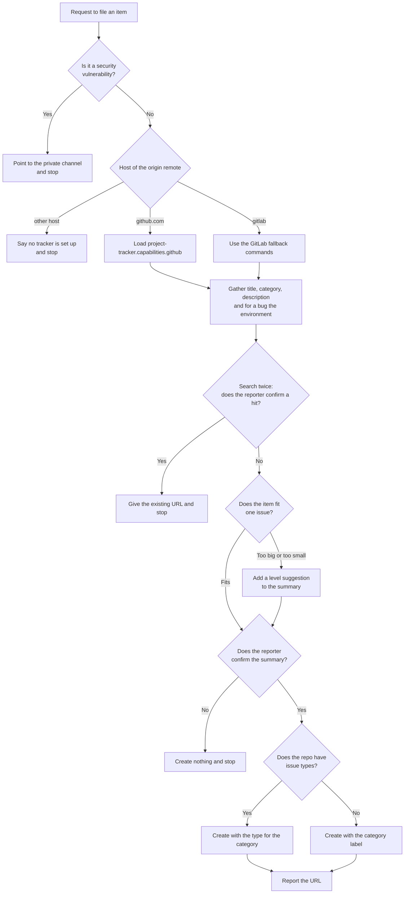

# issue

## What

A person has found a defect, wants a capability, or has a chore to track, and wants it on the
repository's issue tracker as one well-formed item. Left alone, an agent files it without looking
for an existing one, invents labels the repository does not have, and puts the wrong shape of text
in the body.

`issue` files **one item of tracked work**: a **bug**, a **feature**, or a **task**. It gathers the
details, searches for a duplicate, confirms with the person, creates the item, and reports the URL.
It replaces `file-issue` ([ADR 0003](../../design/decisions/0003-split-file-issue-by-level.md)); the
rename is breaking and ships with a major changeset.

**The skill owns the workflow; a capabilities reference owns the tracker.** The tracker's commands
live in `project-tracker.capabilities.<tracker>`, found by listing that name prefix. This unit ships
`project-tracker.capabilities.github` and nothing else. Until GitLab's reference ships, `issue` keeps
a short GitLab fallback inline; Bitbucket is dropped because its native tracker is gone.

**Category and level are separate.** Category (bug, feature, task) says why the work exists. This
skill creates at the issue level only. When an item looks too big or too small, it suggests another
level in the confirmation and files at this one unless the person changes it. It does not promote or
demote.

**What the tracker does with the category.** On GitHub the issue type carries it (`Bug`, `Feature`,
`Task`). A repository without issue types, such as a user-owned one, gets the `bug` or `enhancement`
label, and a task gets a label only if the repository has `task`.

### Non-goals

- Epics, initiatives, and level changes ([ADR 0003](../../design/decisions/0003-split-file-issue-by-level.md): the `epic` and `initiative` skills).
- Comments on an existing item (`to-question`).
- Closing, retyping, or moving an existing item.
- Security vulnerabilities: never a public issue; the skill points to the private channel.

### Settled by the spikes

- Minimum `gh` is 2.98.0, the first release with `--type`, `--parent`, and `--add-sub-issue`
  (release notes of v2.98.0, 2026-06-10). Checked against 2.102.0.
- `--type` on a repository without issue types is **untested**. The reference reads `issueTypes`
  first and never passes `--type` when it is null.

## Use Cases

**Fit:** strong

`issue` makes a real activation decision: its vocabulary ("ticket", "issue", "task") overlaps `to-question`, `community-post`, and the planned `epic` skill. Its steps are judgment, not mechanism (category, duplicate matching, level fit).

**Actors.** A *reporter* (a maintainer or contributor who found something) invokes the skill. A
*sibling skill* (`agent-readiness` offers it for a finding) invokes it on the reporter's behalf. A
*triager* reads the result without invoking anything, and a *private-tracker owner* is affected when
a public issue could leak their details. The triager and the owner are stakeholders; their goals
shape the body and the confirmation.

| # | Use case (surface: `/issue`) | Actor / goal | Entry point | Extensions |
|---|---|---|---|---|
| 1 | **File a bug** | Reporter: get a reproducible defect on the tracker without duplicating one | Trigger: asks to file or report a defect. Inputs: title, description, steps, expected and actual. Outcome: a bug-category issue and its URL | 5–9 |
| 2 | **File a feature** | Reporter: record wanted behavior as its own issue | Same trigger with a request for new behavior. Outcome: a feature-category issue and its URL | 5–9 |
| 3 | **File a task** | Reporter: track a chore that is neither defect nor feature | Same trigger with a chore. Outcome: a task-category issue and its URL | 5–9 |
| 4 | **Let a sibling skill offer filing** | Sibling skill: give the reporter a path to file a finding | The same entry point, with the finding as the description | 5–9 |

**Extensions** (every path that does not reach "an issue exists and its URL is reported"), shared by
use cases 1–4 and drawn in the Control Flow:

5. **A duplicate exists.** The reporter confirms a search hit is the same issue: nothing is created; the existing URL is given.
6. **The reporter does not confirm.** Nothing is created.
7. **The item is a security vulnerability.** The skill points to the private channel and creates nothing.
8. **The host has no tracker set up** (Bitbucket or anything else). The skill says so and creates nothing.
9. **The item is the wrong size.** The confirmation suggests another level; the issue is still filed at this one if the reporter does not change it. Variants: the repo has no issue types (label instead of type), the host is GitLab (fallback commands).

**Surface trace.** The capability takes three inputs: title (every use case), category (every use
case; it decides the template and the type or label), and description (every use case). It exposes
no flags or options, so there are no forbidden combinations.

## Control Flow

The GitLab fallback creates with a label and has no type branch, so `N` applies to the GitHub path.

## Scenario map

### Use cases 1–4 — file an item

| Edge | Path (Given) | Scenario |
|---|---|---|
| `A` (engage) | a repo with `to-question` and `community-post` also installed | `engages to file one item of tracked work, not to comment or plan` |
| `B → C (No)` | an ordinary defect report | `files an ordinary defect instead of treating it as a vulnerability` |
| `C → D (github.com)` | origin is github.com | `maps each category to the tracker's type on a repo with issue types` |
| `G` (gather) | a bug in a package with a Node toolchain | `collects environment details for a bug from the machine` |
| `H → J (No)` | the first search returns hits that are not the reporter's issue | `searches at least twice and shows each hit before creating` |
| `J → L (Fits)` | one deliverable with one owner | `adds no level suggestion to an item that fits one issue` |
| `L → N (Yes)` | the reporter has confirmed the summary | `creates only after the summary is confirmed` |
| `N → P (No)` | issueTypes is null and the repo has bug and enhancement labels | `falls back to labels on a repo without issue types` |
| `O` / `Q` (body) | a confirmed task "migrate the build to tsdown" in a public repo | `writes a task body whose end state and scope can be checked` |
| `O` / `Q` (body) | the same task, with a request that cites a commit SHA and an internal tracker address | `keeps a commit SHA and an internal tracker address out of a public issue body` |
| `O` / `Q` (body) | the same task | `leaves bug-only sections out of a task body` |
| `—` (artifact) | the shipped skill and its two reference copies | `ships a Validate section whose mechanical assertions pass` |
| `C → E (gitlab)` | origin is gitlab.com and no GitLab reference exists | `files on GitLab through the fallback` |

### Extensions 5–9 — the paths that do not file

| Edge | Path (Given) | Scenario |
|---|---|---|
| `H → I (Yes)` | a search hit the reporter confirms is the same issue | `stops at a confirmed duplicate` |
| `L → M (No)` | the reporter declines the summary | `creates nothing when the user declines` |
| `B → Z (Yes)` | the report describes an unauthenticated remote code execution | `does not file a vulnerability publicly` |
| `C → F (other host)` | origin is bitbucket.org | `refuses a host with no tracker set up` |
| `J → K (Too big or too small)` | one request covering five independently shippable features | `suggests another level for an oversized item and still files at issue level` |
| `J → K (Too big or too small)` | a one-character typo fix in a comment | `suggests not tracking an item too small for an issue` |
