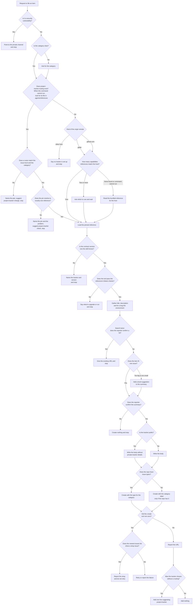

# issue

## What

A person has found a defect, wants a capability, or has a chore to track, and wants it on the
repository's issue tracker as one well-formed item. Left alone, an agent files it without looking
for an existing one, invents labels the repository does not have, and puts the wrong shape of text
in the body.

`issue` files **one item of tracked work**: a **bug**, a **feature**, or a **task**. It gathers the
details, searches for a duplicate, confirms with the person, creates the item, and reports the URL.
It replaces `file-issue` ([ADR 0003](../../design/decisions/0003-split-file-issue-by-level.md)); the
rename is breaking and ships with a major changeset.

**The skill owns the workflow; a capabilities reference owns the tracker.** The tracker's commands
live in `project-tracker.capabilities.<tracker>`, found by listing that name prefix. This unit ships
`project-tracker.capabilities.github` and `project-tracker.capabilities.gitlab`, and loads the one for
the `origin` host from its own folder when nothing installed matches; Bitbucket is dropped because its
native tracker is gone.

**Templates and level checks are references.** The body template for each category is
`repobuddy.work-template.<category>`, and the checks that say an item is too big or too small are the
issue sections of `repobuddy.work-levels`. The skill loads them by name through agent-harness, so a
project overrides one section with `merge-sections`. The capabilities reference declares the
`contract:` it follows, and the skill stops on a version `project-tracker.contract` does not name. The
references are specified in [work-references](../work-references/README.md).

**A routing, when the project has one, decides the tracker.** `project-tracker.routing` (written by
the [project-tracker](../project-tracker/README.md) skill) pins a tracker to each level and category.
With a routing, `issue` takes the first row that matches the issue level and the category, loads the
pinned reference instead of detecting the tracker from the `origin` host, and files there. It never
guesses: a pin that resolves to nothing or to two plugins, or a level and category no row matches,
stops the skill with the problem named. Without a routing it behaves as before, and its report ends
with one line suggesting `project-tracker`. The table format is in `project-tracker.contract`.

**Category and level are separate.** Category (bug, feature, task) says why the work exists. This
skill creates at the issue level only. When an item looks too big or too small, it suggests another
level in the confirmation and files at this one unless the person changes it. It does not promote or
demote.

**What the tracker does with the category.** On GitHub the issue type carries it (`Bug`, `Feature`,
`Task`). A repository without issue types, such as a user-owned one, gets the `bug` or `enhancement`
label, and a task gets a label only if the repository has `task`.

### Non-goals

- Epics, initiatives, and level changes ([ADR 0003](../../design/decisions/0003-split-file-issue-by-level.md): the `epic` and `initiative` skills).
- Comments on an existing item (`to-question`).
- Closing, retyping, or moving an existing item.
- Security vulnerabilities: never a public issue; the skill points to the private channel.

### Settled by the spikes

- Minimum `gh` is 2.98.0. `--type`, `--parent`, and `--add-sub-issue` arrived in 2.94.0 (2026-06-10);
  the duplicate search's `--search-type hybrid` arrived in 2.98.0. Checked against 2.102.0.
- `--type` on a repository without issue types was **tested** (a private user-owned scratch repo, 2026-10-11): `gh issue create --type Bug` creates the issue untyped, then exits 1 with `type "Bug" not found; available types:`. The reference reads `issueTypes` first, never passes `--type` when it is null, and checks for a stray issue after any failed create. A missing `--label` fails with `could not add label` and creates nothing.
- Live-tested on GitHub: bug, feature, and task with `--type` on an org repo (#809 to #811), and the label path on a user-owned repo. GitLab is untested: `glab` is not installed and no GitLab host is authenticated here. Its reference
  follows GitLab's documentation and marks each call *(untested)*; the Free and Premium runs are owed (#806).

## Use Cases

**Fit:** strong

`issue` makes a real activation decision: its vocabulary ("ticket", "issue", "task") overlaps `to-question`, `community-post`, and the planned `epic` skill. Its steps are judgment, not mechanism (category, duplicate matching, level fit).

**Actors.** A *reporter* (a maintainer or contributor who found something) invokes the skill. A
*sibling skill* (`agent-readiness` offers it for a finding) invokes it on the reporter's behalf. A
*triager* reads the result without invoking anything, and a *private-tracker owner* is affected when
a public issue could leak their details. The triager and the owner are stakeholders; their goals
shape the body and the confirmation.

| # | Use case (surface: `/issue`) | Actor / goal | Entry point | Extensions |
|---|---|---|---|---|
| 1 | **File a bug** | Reporter: get a reproducible defect on the tracker without duplicating one | Trigger: asks to file or report a defect. Inputs: title, description, steps, expected and actual. Outcome: a bug-category issue and its URL | 5–14, 17 |
| 2 | **File a feature** | Reporter: record wanted behavior as its own issue | Same trigger with a request for new behavior. Outcome: a feature-category issue and its URL | 5–14, 17 |
| 3 | **File a task** | Reporter: track a chore that is neither defect nor feature | Same trigger with a chore. Outcome: a task-category issue and its URL | 5–14, 17 |
| 4 | **Let a sibling skill offer filing** | Sibling skill: give the reporter a path to file a finding | The same entry point, with the finding as the description | 5–14, 17 |
| 5 | **File to the routed tracker** | Reporter: have the item land on the tracker the team chose for its category | Same trigger, in a project with `project-tracker.routing`. Outcome: the item on the routed tracker and its URL | 5–7, 9, 10, 12–17 |

**Extensions** (every path that does not reach "an issue exists and its URL is reported"). Use cases 1–4 mean a project with no routing, so 15 and 16 do not arise for them; 8, 11, and the GitLab variant of 9 do not arise for use case 5, which skips the host. They are shared by
use cases 1–5 and drawn in the Control Flow:

5. **A duplicate exists.** The reporter confirms a search hit is the same issue: nothing is created; the existing URL is given.
6. **The reporter does not confirm.** Nothing is created.
7. **The item is a security vulnerability.** The skill points to the private channel and creates nothing.
8. **The host has no tracker set up** (Bitbucket or anything else). The skill says so and creates nothing.
9. **The item is the wrong size.** The confirmation suggests another level; the issue is still filed at this one if the reporter does not change it. Variants: the repo has no issue types (label instead of type), the host is GitLab (labels, through the bundled GitLab reference).
10. **The category is unclear.** The skill asks for it before gathering anything else.
11. **More than one capabilities reference matches the host.** The skill asks which to use and loads neither until answered.
12. **`gh` is older than 2.98.0 or logged out.** The skill says what to upgrade or run, and creates nothing.
13. **The capabilities reference's contract version is unknown or missing.** The skill names the tracker and the version, and creates nothing.
14. **A create fails.** The skill lists the newest issues before any retry. A stray issue the failed create left behind is not retried, and its URL is the one reported as the new issue (`--type` on a repo without types creates the issue, then exits 1); with none, the skill says nothing was filed before any retry.
15. **A route's pin resolves to nothing, to a bare name two plugins hold, or cannot be read because the `reference` command cannot run.** The skill names the pin and the problem, suggests running `project-tracker` check, and creates nothing.
16. **No route matches the issue level and the category.** The skill names the pair, suggests running `project-tracker` change, and creates nothing.
17. **The tracker is public.** The body keeps out anything from a private tracker, whatever the repository's own visibility; on a private tracker it keeps what the request cites.

**Surface trace.** The capability takes three inputs: title (every use case), category (every use
case; it decides the template and the type or label), and description (every use case). It exposes
no flags or options, so there are no forbidden combinations.

## Control Flow

A tracker other than GitHub, GitLab included, meets `N` through its own reference's `Kinds` and `Create` sections, which stand where this graph says type or label. The `X` check follows the
reference's `Create` section, which lists the newest issues before any retry.

## Scenario map

### Use cases 1–4 — file an item

| Edge | Path (Given) | Scenario |
|---|---|---|
| `A` (engage) | a repo with `to-question` and `community-post` also installed | `engages to file one item of tracked work, not to comment or plan` |
| `B → W (No)` | an ordinary defect report | `files an ordinary defect instead of treating it as a vulnerability` |
| `N → O (Yes)` | origin is github.com and the repo has issue types | `maps each category to the tracker's type on a repo with issue types` |
| `G` (gather) | a bug in a package with a Node toolchain | `collects environment details for a bug from the machine` |
| `C → R (github.com)` | one capabilities reference matches the host | `lists the capabilities references and loads the one that matches the host` |
| `R → R3 (None found or command cannot run)` | the reference command cannot run | `reads the bundled GitHub reference when the reference command cannot run` |
| `R → R3 (None found or command cannot run)` | the search runs and returns no names, or only a fuzzier match | `reads the bundled GitHub reference when the reference search finds no match` |
| `T → G (Yes)` | a confirmed task and a project override of one template section | `writes the body from the template reference, not from the skill` |
| `J → K` | a project override of the Too big section | `follows a project override of the level checks` |
| `T → G (Yes)` | a request that says it is a bug | `writes a bug body with steps, expected, and actual behavior` |
| `T → G (Yes)` | a request that wants new behavior | `writes a feature body with the need and use cases, and no bug sections` |
| `N → P (No)` | the repo has no enhancement label | `omits the label when the repo does not have it` |
| `H → J (No)` | the first search returns hits that are not the reporter's issue | `searches at least twice and shows each hit before creating` |
| `J → L (Fits)` | one deliverable with one owner | `adds no level suggestion to an item that fits one issue` |
| `L → BP (Yes)` | the reporter has confirmed the summary | `creates only after the summary is confirmed` |
| `N → P (No)` | issueTypes is null and the repo has bug and enhancement labels | `falls back to labels on a repo without issue types` |
| `O` / `Q` (body) | a confirmed task "migrate the build to tsdown" in a public repo | `writes a task body whose end state and scope can be checked` |
| `O` / `Q` (body) | the same task, with a request that cites a commit SHA and an internal tracker address | `keeps a commit SHA and an internal tracker address out of a public issue body` |
| `O` / `Q` (body) | the same task | `leaves bug-only sections out of a task body` |
| `—` (artifact) | the shipped skill and its reference copies | `ships a Validate section whose mechanical assertions pass` |
| `RT → C (No)`, `C → R (gitlab)`, `R → R3` | no routing exists, origin is gitlab.com and no GitLab reference is installed | `files on GitLab through the bundled GitLab reference` |

### Extensions 5–14 — the paths that do not file

| Edge | Path (Given) | Scenario |
|---|---|---|
| `T → Y (No)` | gh 2.97.0 is installed | `stops with an upgrade message when gh is older than 2.98.0` |
| `R → R2 (Two or more)` | two plugins ship a reference for the host | `asks which capabilities reference to use when two match` |
| `W → W2 (No)` | a request that says only "file this" | `asks for the category when the request does not give one` |
| `W2 → RT` | the same request, in a project with a routing that sends bugs elsewhere | `asks for the category before choosing a route` |
| `H → I (Yes)` | a search hit the reporter confirms is the same issue | `stops at a confirmed duplicate` |
| `L → M (No)` | the reporter declines the summary | `creates nothing when the user declines` |
| `B → Z (Yes)` | the report describes an unauthenticated remote code execution | `does not file a vulnerability publicly` |
| `RT → C (No)`, `C → F (other host)` | no routing exists, origin is bitbucket.org | `refuses a host with no tracker set up` |
| `J → K (Too big or too small)` | one request covering five independently shippable features | `suggests another level for an oversized item and still files at issue level` |
| `J → K (Too big or too small)` | a one-character typo fix in a comment | `suggests not tracking an item too small for an issue` |
| `V → V2 (No)` | a capabilities reference with an unknown or missing contract version | `stops on a capabilities reference whose contract version it does not know` |
| `O → X (Yes), S (Yes)` | a failed create left an issue with the confirmed title | `does not retry a failed create that left an issue behind` |
| `P → X (Yes), S (No)` | a failed create left nothing behind | `lists the newest issues after a failed create that left nothing behind` |

### Use case 4 — a sibling skill offers filing

A handed-over finding enters at `G`, and the typed scenarios' Givens do not pin that entry, so each edge is stated again for it.

| Edge | Path (Given) | Scenario |
|---|---|---|
| `G → H` | a finding handed over by `agent-readiness` | `searches for duplicates before filing a finding a sibling skill hands over` |
| `H → I (Yes)` | the same, with a hit the user confirms | `stops at a confirmed duplicate of a finding a sibling skill hands over` |
| `L → BP (Yes)` / `L → M (No)` | the same, no hit is the user's issue | `creates a finding a sibling skill hands over only when the user confirms the summary` |
| `B → W (No)` | an ordinary finding from `agent-readiness` | `files an ordinary finding from a sibling skill instead of treating it as a vulnerability` |
| `B → Z (Yes)` | a finding that leaks a token | `does not file a security finding from a sibling skill publicly` |

### Use case 5 — file to the routed tracker

| Edge | Path (Given) | Scenario |
|---|---|---|
| `RP → D (Yes)` | a route sends bugs to a tracker other than the origin host's | `files to the routed tracker instead of the origin host's` |
| `RR → RP (Yes)` | a bug matches both a bug row and a later catch-all | `takes the first matching route over a later catch-all` |
| `RR → RP (Yes)` | a feature matches only the catch-all after a bug row | `falls through to the catch-all when no earlier row matches` |
| `RR → RR2 (No)` | a routing with no row for the category | `stops when no route matches the category` |
| `RP → RP2 (No)` | the pinned plugin holds no such reference, or the bare pin names two plugins | `stops when a route's pin does not resolve to one reference` |
| `RP → RP2 (No)` | the routing file exists and the reference command cannot run | `stops when a routing exists and the reference command cannot run` |
| `U → U2 (Yes)` | no routing exists | `suggests project-tracker once in the report when no routing exists` |
| `U → U3 (No)` | a routing exists and the item is filed | `adds no suggestion to the report when a routing chose the tracker` |
| `BP → BP2 (Yes)` | the routed tracker is public and the repository is private | `keeps private-tracker details out of an item filed on a public routed tracker` |
| `BP → BP3 (No)` | the routed tracker is private | `keeps a private-tracker reference in an item filed on a private routed tracker` |
