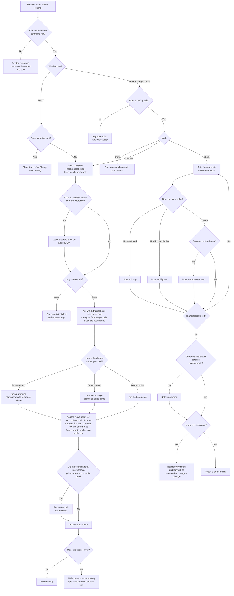

# project-tracker

## What

A team may keep bugs in GitHub issues, feature requests in another tracker, and epics in a private
one. The level skills (`issue` today, `epic` and `initiative` later) must know which tracker holds
what, and must not guess. Without a recorded answer, an agent files everything on the host of the
`origin` remote, or picks a tracker by luck.

`project-tracker` records the answer. It is a **routing skill** ([ADR 0002](../../design/decisions/0002-routing-skills-are-named-noun-first.md))
with four modes: **set up**, **show**, **change**, and **check** the project's **routing**, the
reference `project-tracker.routing` in the project's `.agents/references/` folder
([ADR 0003](../../design/decisions/0003-split-file-issue-by-level.md), decisions 4, 5, 8, 9).

**The routing holds two tables.** `Routes` has the columns `Level`, `Category`, and `Tracker`: which
tracker holds each level and category. The first row that matches wins, and `any` matches
everything, so specific rows go first and a catch-all last. `Moves` has the columns `From`, `To`, and
`Source after the move`: what happens to the source when an item moves from the `From` tracker to the
`To` tracker, `moved` (close the source as moved) or `mirror` (keep it open). A pair with no row
means `moved`, except that a move from a private tracker to a public one is never allowed, with a row
or without: a level skill that meets that pair stops. Every `Tracker`, `From`, and `To` cell holds a
pin. Each tracker is **pinned** as `<plugin>/project-tracker.capabilities.<tracker>`,
so two plugins that ship the same tracker never get mixed up. A tracker that only the project itself
defines has no plugin and is pinned by its bare name. The table formats are in
`project-tracker.contract`, which `issue` reads as well; the skill ships its own copy of that file,
generated from the canonical one by `scripts/sync-skill-references.mjs`.

**Trackers are discovered, not named.** The skill lists the installed capabilities with
`reference search project-tracker.capabilities` and keeps only hits whose `match` is `prefix`; the
search also returns fuzzier hits (the contract, and the routing itself once it exists) that must be dropped. A new tracker
appears the moment its package is installed, with no change here.

**A private tracker's details never go into a public one.** The skill reads each tracker's
visibility from its capabilities reference. It writes no `Moves` row that carries an item from a
private tracker to a public one, and it refuses to; the contract says that pair is never allowed.

Key terms: **routing** is the project's record of which tracker holds what; a **route** is one row of
it; a **pin** is a tracker's qualified reference name; a **capabilities reference** is what one
tracker supplies to the level skills.

### Non-goals

- Filing, moving, or retyping an item. `issue` files; the `epic` skill will move.
- Writing a capabilities reference for any tracker. A GitHub Discussions, Linear, or Jira reference
  is not part of this skill; routing works for whatever references are installed.
- Deciding whether GitHub Discussions counts as a tracker.
- Choosing a tracker for the user. The skill asks.
- Checking the `Moves` table. Every `From` and `To` pin there comes from a route, so a route problem
  shows first, and a hand-written private-to-public row is stopped by the level skill that meets it
  (the contract says the pair is never allowed).
- A malformed routing file, such as a missing table.

### Settled by testing the resolver

Run against `@cyberuni/agent-harness` with a scratch project and three fake provider packages
(2026-10-11):

- `reference search project-tracker.capabilities` returns a tracker one plugin ships by its bare
  name, a tracker two plugins ship once per plugin with the `<plugin>/` prefix, and the routing
  itself with `match: body`.
- `reference show <name>` on a bare name two plugins hold exits 1 with `held by more than one
  plugin; ask for one of ...`. A pin whose plugin does not hold the name exits 1 with `no reference
  named ...`. A qualified pin resolves.
- `reference where <bare name>` names the plugin that holds it (`plugin prov-gh`), which is how a
  bare search hit becomes a qualified pin.
- `reference show --format json` carries the frontmatter, so `contract:` is read from `metadata`.

## Use Cases

**Fit:** strong

The skill makes a real engagement decision (its words, "tracker" and "route", sit near `issue`) and
its steps are judgment: which trackers to offer, which pin form, which pairs to refuse.

**Actors.** A *maintainer* runs the skill. A *level skill* (`issue`, later `epic` and `initiative`)
reads the routing it writes, without invoking the skill. A *capabilities author* (a package or a
team) is affected: their reference appears in set-up with no change to this skill. A *private-tracker
owner* is affected when a move could carry their details into a public tracker.

| # | Use case (surface: `/project-tracker`) | Actor / goal | Entry point | Extensions |
|---|---|---|---|---|
| 1 | **Set up** | Maintainer: record which tracker holds each level and category, and what a move does to its source | Trigger: asks to set up where issues, epics, or features go. Inputs: answers about trackers and move policy. Outcome: `project-tracker.routing` written | 1–3, 5–9 |
| 2 | **Show** | Maintainer: see where each kind of work goes | Trigger: asks where issues go or to show the routing. Outcome: the routes and moves in plain words, nothing written | 1, 4 |
| 3 | **Change** | Maintainer: send one kind of work elsewhere without redoing the rest | Trigger: asks to move bugs to another tracker. Outcome: the routing rewritten with every untouched route and move kept | 1–5, 7–9 |
| 4 | **Check** | Maintainer: learn whether the routing still works after an install, an upgrade, or a removal | Trigger: asks to check the routing. Outcome: each problem named with its route and pin, or a clean report; nothing written | 1, 4, 10–13 |

**Extensions** (every path that does not end in "the routing is written" or "the answer is given"):

1. **The `reference` command cannot run.** The skill says so and stops; nothing can be listed or read.
2. **No capabilities reference is left** after fuzzier hits and unknown contract versions are dropped. The skill says none is installed and writes nothing.
3. **A reference's contract version is unknown or missing.** The skill leaves it out of the choices and says why. Change goes through the same listing, so it applies there too.
4. **No routing exists** (show, change, check). The skill says so and offers set-up.
5. **The user declines the summary.** Nothing is written.
6. **A routing already exists** (set up). The skill shows it and offers change; it overwrites nothing.
7. **Two plugins ship the same tracker.** The skill asks which, and pins the qualified name.
8. **A move would go from a private tracker to a public one.** The skill refuses that pair and writes no row for it.
9. **The tracker is defined in the project's own references.** There is no plugin to qualify with, so the pin is the bare name.
10. **A route's pin resolves to nothing** (check): the route is reported as missing.
11. **A route's pin is a bare name two plugins hold** (check): reported as ambiguous.
12. **A route's reference has a contract version the skill does not know** (check): reported with the tracker and the version.
13. **A level and category pair matches no route** (check): reported as uncovered.

**The coverage universe.** Check asks about nine cells: the three levels (issue, epic, initiative)
crossed with the three categories (bug, feature, task). A cell is covered when some route matches it.

**Ordered pairs.** A move has a direction, so the policy is asked for each ordered pair of routed
trackers (alpha to beta and beta to alpha are two pairs) that has no `Moves` row, and a pair that goes
from a private tracker to a public one is never asked: the skill says why, and writes no row, if the
user volunteers it.

**Surface trace.** The skill takes one input, the mode (set up, show, change, check), plus the user's
answers. It exposes no flags or options, so there are no forbidden combinations. Every mode is
justified by use cases 1 to 4.

## Control Flow

Change runs the set-up path from `F`, so it lists trackers, filters by contract version, and pins
the way set-up does. It asks only about the levels and categories the user names, and about the
pairs that have no `Moves` row yet, so every route and move it does not touch is copied unchanged
into what is written. Its summary, decline, and write are the set-up ones at `M` and `N`. Check
notes every problem it meets while it walks the routes, then checks coverage once, and reports all
the notes together at `X1`; it writes nothing.

## Scenario map

### Use case 1 — set up

| Edge | Path (Given) | Scenario |
|---|---|---|
| `A` (engage) | a repo where `issue` and `to-question` are also installed | `engages to set up, show, change, or check tracker routing, not to file or comment` |
| `F → G` | the search returns a prefix hit and a description hit | `lists installed capabilities by prefix and drops the fuzzier matches` |
| `G → G2 (No)` | one reference declares contract 2 | `leaves out a capabilities reference whose contract version it does not know` |
| `H → H2 (None)` | the only reference left after filtering is none | `says no capabilities are installed and writes nothing` |
| `J → J1 (By one plugin)` | one plugin ships the tracker | `pins a tracker one plugin ships as plugin/name` |
| `J → J2 (By two plugins)` | two plugins ship the tracker | `asks which plugin when two ship the same tracker and pins the qualified name` |
| `J → J3 (By the project)` | the project's own references define the tracker | `pins a tracker the project defines by its bare name` |
| `K → L`, `L → M (No)` | a public tracker alpha and a private tracker beta | `asks the move policy for each pair of routed trackers` |
| `L → L2 (Yes)` | the user asks for a move from the private tracker to the public one | `refuses a move from a private tracker to a public one` |
| `N → O (Yes)` | the summary shown | `writes the routing only after the user confirms the summary` |
| `N → O (Yes)` | a default tracker and one exception for bugs | `writes specific rows before the catch-all` |
| `N → N2 (No)` | the summary shown | `writes nothing when the user declines the summary` |
| `D → D2 (Yes)` | a routing already exists | `shows an existing routing instead of overwriting it` |
| `B → Z (No)` | the reference command exits with an error | `stops when the reference command cannot run` |

### Use cases 2–4 — show, change, check

| Edge | Path (Given) | Scenario |
|---|---|---|
| `E → E2 (No)` | any of show, change, check, with no routing | `says no routing exists and offers set-up` |
| `P → P1 (Show)` | a routing with two routes and one move | `shows each route and move in plain words and writes nothing` |
| `P → F (Change)` | a routing with three routes and one move | `changes one route, lists trackers again, and keeps every other route and move` |
| `R → R1 (Nothing found)` | a pin naming a plugin that holds no such reference | `reports a route whose capabilities reference is missing` |
| `R → R2 (Held by two plugins)` | a bare pin and two plugins holding the name | `reports a route whose tracker two plugins ship` |
| `S → S1 (No)` | the pinned reference declares contract 2, or none | `reports a route on a contract version it does not know` |
| `T → T1 (No)` | every pin resolves and the one route leaves issue with category feature, among others, with no match | `reports a level and category that no route covers` |
| `X → X2 (No)` | every pin resolves and every cell matches | `reports a clean routing when every route resolves` |
| `QN → Q (Yes)`, `X → X1 (Yes)` | one pin missing and one level and category uncovered | `reports every problem in one run, not only the first` |

### Artifact

| Edge | Path (Given) | Scenario |
|---|---|---|
| `—` (artifact) | the shipped skill | `ships a Validate section whose mechanical assertions pass` |
