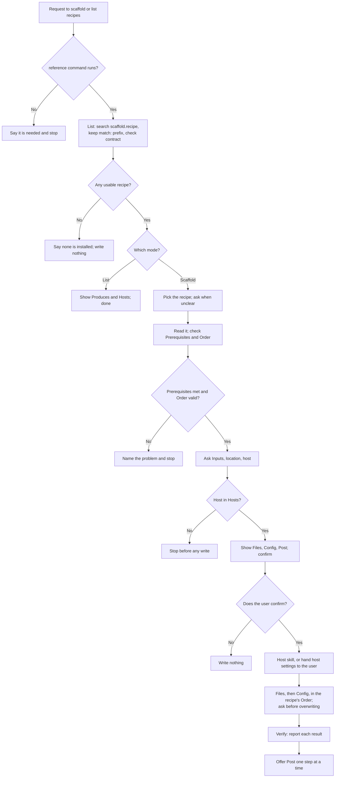

# scaffold

## What

A team starts each new repository or package the same way: the same files, the same pinned settings,
the same checks, and the same steps after the first push. Left alone, an agent rebuilds that from
memory each time, picks a template the team does not use, writes files before anyone has seen the plan,
skips the host's basic settings or redoes them by hand, and calls the result done while a check fails.

`scaffold` applies a **scaffold recipe**: a reference a plugin ships as `scaffold.recipe.<name>` that
holds the details of one kind of project. repobuddy owns the recipe format, `scaffold.contract`
(contract 1), and the skill; a plugin implements a recipe and depends on the contract, never the other
way round, as with `project-tracker` and its capabilities references. The skill names no recipe and
carries no recipe's details. It has two modes:

- **List**: every reference found by the `scaffold.recipe` prefix (only `match: prefix` hits), each
  with its `Produces` and `Hosts`. A recipe whose `contract` is missing or is not a version the contract
  declares is left out and named.
- **Scaffold**: pick the recipe, read it, check its `Prerequisites` and its `Order`, ask its `Inputs`,
  the location, and the host, show the plan, and after one confirmation run the host skill, apply
  `Files` and `Config`, run `Verify`, and offer `Post` one step at a time.

**The order of work is fixed unless the recipe says otherwise.** The default is `Recipe`, `Inputs`,
`host setup`, `Files`, `Config`, `Verify`, `Post`. A recipe that needs another order lists the steps
after `Recipe` in an `Order` bullet, each once; a list that leaves one out, repeats one, or names an
unknown one stops the skill before any write. The confirmation always comes before the first step that
writes.

**The host's basic settings belong to the host skill.** Branch protection, merge settings, and
dependency updates run through the host skill (`setup-github-repo` for `github`); a host with no skill
is the user's to set up, and the skill continues only when they say so. A host not listed in the
recipe's `Hosts` stops the skill before any write.

**Nothing is written before the confirmation**, no existing file is overwritten without asking, each
`Post` step touches a service outside the repository and runs only when accepted, and a failing
`Verify` check is reported as a failure.

**The skill needs the `reference` command** from the `cyber-agent-harness` plugin. Without it no recipe
can be listed or read, so the skill says so and stops.

### Non-goals

- Writing or editing a recipe, or copying a recipe's details into the skill.
- Changing a host's basic settings by hand.
- A GitLab host skill. A recipe may list `gitlab`; the skill then hands its basic settings to the user.
- Updating a project already scaffolded when its recipe changes.

### Input from a real recipe

None yet. The first planned recipe, `scaffold.recipe.panwds` in `panwds/buddy`, has not landed in a
repository reachable from here, so no recipe has been run through the skill, dry or otherwise. The
scenarios below use made-up recipes. This section is replaced when a real recipe is walked through.

## Use Cases

**Fit:** moderate

Its triggers ("scaffold", "new repo", "new package") sit next to `setup-github-repo`, which also sets
up a repository, and `init-buddy`, which adds repobuddy to an existing one. The judgment is in reading a
recipe the skill has never seen and keeping its writes behind one confirmation; the steps are the
recipe's.

**Actors.** A *developer* runs the skill. A *recipe author* ships `scaffold.recipe.<name>` in a plugin.
A *host skill* sets up the hosting platform's basic settings. A *team* overrides one section of a
recipe.

| # | Use case (surface: `/scaffold`) | Actor / goal | Entry point | Extensions |
|---|---|---|---|---|
| 1 | **List** | Developer: see what can be scaffolded | Trigger: asks what can be scaffolded. Outcome: each usable recipe with what it produces and its hosts | 1–3 |
| 2 | **Scaffold** | Developer: start a project from a recipe | Trigger: asks to scaffold a repo or package. Outcome: the files and settings written, checks run, `Post` offered | 1–11 |

**Extensions:**

1. **The `reference` command cannot run.** The skill says it is needed and stops.
2. **No recipe is installed.** The skill says so and writes nothing.
3. **A recipe's `contract` is missing or unknown.** It is left out and named with its version.
4. **More than one recipe fits, or none does, or two plugins ship the same name.** The skill asks.
5. **A prerequisite is missing.** The skill names it and stops.
6. **`Order` is invalid.** The skill names the problem and stops before any write.
7. **The host is not in `Hosts`.** The skill stops before any write.
8. **The user declines the plan.** Nothing is written.
9. **The host has no host skill.** The user is told the basic settings are theirs; the skill continues only on their word.
10. **A file already exists.** It is overwritten only on a yes.
11. **A `Verify` check fails.** It is reported as failing and the scaffold is not called done.

## Control Flow

## Scenario map

| Edge | Path (Given) | Scenario |
|---|---|---|
| `A` (engage) | a repo where `setup-github-repo` and `init-buddy` are installed | `engages to scaffold a project or list recipes, not to set up an existing repo` |
| `B → B1` | the `reference` command is not installed | `stops when the reference command cannot run` |
| `L0 → L1` | no `scaffold.recipe.*` reference installed | `says no recipe is installed and writes nothing` |
| `L` | three prefix hits, one on contract 2, plus an exact-name hit | `lists only prefix hits on a known contract` |
| `E0 → E1` (Order) | a recipe whose `Order` leaves out `Verify` | `stops on an Order that leaves out a step` |
| `F0 → F1` | a recipe with `Hosts: github` and the user on GitLab | `stops when the host is not in the recipe's Hosts` |
| `N → N1` | the plan shown and declined | `writes nothing when the user declines the plan` |
| `H → W` (default order) | a GitHub recipe with no `Order` | `runs the host skill before writing the files` |
| `W` (recipe order) | a recipe with `Order: Inputs, Files, host setup, Config, Verify, Post` | `follows the recipe's Order after the confirmation` |
| `V` | one `Verify` check fails | `reports a failing check and does not call the scaffold done` |
| `P` | two `Post` steps, one declined | `runs only the Post steps the user accepts` |
| `—` (artifact) | the shipped skill | `ships a Validate section whose mechanical assertions pass` |
